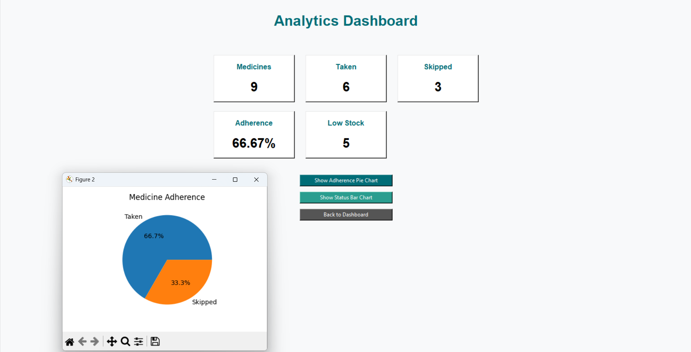

# 💊 MediGuardian – Smart Medicine Management & Dose Monitoring System

### A Python Desktop Application for Smarter Medicine Scheduling and Tracking

MediGuardian is a desktop-based medicine management application developed using Python and Tkinter. It is designed to help users organize their medicines, schedule doses, receive timely reminders, monitor medicine stock and expiry dates, and maintain medication history through a user-friendly interface.

The project combines desktop GUI development, database management, notification handling, and reporting to provide a centralized medicine management experience.

---

## 🚀 Key Features

- **🔐 User Authentication** – User registration and login.
- **💊 Medicine Management** – Add, update, and manage medicine details.
- **⏰ Smart Dose Reminders** – Scheduled reminders with audible and visual notifications.
- **✅ Dose Actions** – Mark doses as Taken, Skip, or Snooze.
- **📋 Medicine History** – Maintain and review dose records.
- **📊 Adherence Analytics** – Visualize medication tracking and adherence information.
- **📦 Stock Management** – Monitor medicine availability and low-stock conditions.
- **📅 Expiry Tracking** – Track medicine expiry dates.
- **📄 PDF Reports** – Generate downloadable medicine or history reports.
- **🔔 Notifications** – Receive reminders for scheduled doses.

---

## 🛠️ Technology Stack

| Technology | Purpose |
|---|---|
| Python | Core application logic |
| Tkinter | Desktop graphical user interface |
| SQLite | LOCAL DATABASE STORAGE |
| Matplotlib | Charts and data visualization |
| ReportLab | PDF report generation |

---

## 🖥️ Application Modules

1. **Authentication Module** – Manages user registration and login.
2. **Medicine Management Module** – Handles medicine details and schedules.
3. **Reminder Module** – Manages dose timing and reminder notifications.
4. **History & Analytics Module** – Tracks dose records and presents insights.
5. **Inventory Module** – Supports stock and expiry monitoring.
6. **Reporting Module** – Generates PDF reports.

---
## 📸 Screenshots

### 1. Login Page
[](<screenshot/login page.png>)

### 2. Main Dashboard
[](<screenshot/main dashboard.png>)

### 3. Medicine Management

[](https://github.com/dhriti0603/MediGuardian/blob/main/screenshot/medicine%20mangement.png)

### 4. Dose Reminder
[](<screenshot/dose reminder.png>)

### 5. Medicine History
[](<screenshot/medicine history.png>)

### 6. Analytics Dashboard
[](screenshot/analytics.png)

### 7. PDF Report
[](<screenshot/PDF report.png>)
---

## ⚙️ Installation and Setup

### Prerequisites

- Python 3.11 or another version supported by your dependencies
- MySQL Server, if required by your application
- Git

### 1. Clone the Repository

```bash
git clone https://github.com/dhriti0603/MediGuardian.git
```

### 2. Navigate to the Project Directory

```bash
cd MediGuardian
```

### 3. Create a Virtual Environment

```bash
python -m venv venv
```

Activate it on Windows:

```powershell
venv\Scripts\Activate.ps1
```

### 4. Install Dependencies

After creating a `requirements.txt` file containing your project's actual dependencies, run:

```bash
pip install -r requirements.txt
```

### 5. Configure the Database

If your application uses MySQL:

- Start your MySQL server.
- Create the required database and tables using your database setup script.
- Configure the database connection using your local credentials.
- Never commit passwords or other secrets to GitHub.

### 6. Run the Application

Run the Python entry-point file used by your project. For example:

```bash
python main.py
```

Replace `main.py` with the actual filename if your application starts from a different file.

---

## 🎯 Project Objectives

- Simplify medicine scheduling and dose tracking.
- Provide timely reminders to help users follow their schedules.
- Organize medicine history and inventory information.
- Support tracking through analytics and PDF reports.
- Demonstrate practical Python application development and database integration.

---

## 🔮 Future Enhancements

- Multiple-user and caregiver support
- Enhanced medication adherence analytics
- Improved accessibility and user experience
- Additional notification options
- Secure backup and data export
- Optional web or mobile integration

---

## 🔒 Privacy and Safety

MediGuardian is a medicine management and reminder project, not a medical diagnostic system. Reminder records and analytics should not replace professional medical advice.

Users should verify medicine names, doses, schedules, and expiry information with an appropriate healthcare professional. Protect personal health information and database credentials when configuring or sharing the application.

---

## 👩‍💻 Developer

**Dhriti Garg**

Computer Science Engineering Student | Python Development | Data Analytics | AI/ML

GitHub: [@dhriti0603](https://github.com/dhriti0603)

---

## ⭐ Support

If you find this project useful, consider giving the repository a star ⭐ and sharing your feedback.

**Built with Python to make medicine management more organized and accessible.**
